<div align="center">

# Cicada Emergence Optimizer (CEO)

### Cicada Emergence Optimizer: A Hybrid Success-History Differential Evolution with Staggered Brood Restarts

**Van Van Chau**<sup>1,2</sup> · **Minh Tuan Nguyen**<sup>1,&#42;</sup> · **Phayung Meesad**<sup>2,&#42;</sup>

<sup>1</sup> Faculty of Information Technology, Posts and Telecommunications Institute of Technology, 11 Nguyen Dinh Chieu Street, Sai Gon Ward, Ho Chi Minh City 700000, Vietnam<br>
<sup>2</sup> Department of Information Technology Management, Faculty of Information Technology and Digital Innovation, King Mongkut's University of Technology North Bangkok (KMUTNB), 1518 Pracharat 1 Rd, Wongsawang, Bangsue, Bangkok 10800, Thailand<br>
<sup>&#42;</sup> Corresponding authors: minhtuan@ptit.edu.vn, phayung.m@itd.kmutnb.ac.th

*Expert Systems with Applications* (under review)

  

</div>

---

## Contents
[Abstract](#abstract) · [Contributions](#contributions) · [The algorithm](#the-algorithm) · [Benchmarks](#benchmarks) · [Results](#results) · [Reproducing the study](#reproducing-the-study) · [Repository layout](#repository-layout) · [Citation](#citation)

## Abstract
Differential Evolution (DE) and its success-history variants remain among the strongest optimizers for continuous black-box problems. However, many DE variants restart a stalled population all at once, so progress in regions that were still improving is lost. We propose the Cicada Emergence Optimizer (CEO), a hybrid that keeps the search operators of Success-History based Adaptive DE with Linear Population Size Reduction (L-SHADE) and adds a restart schedule for sub-populations. The population is split into broods that keep their own success memories and check their progress on staggered clocks. A stalled brood is resampled around its best member, and after repeated failures it is redrawn over the whole domain; restarts are thus spread over the run while the other broods keep searching. CEO was compared with swarm-intelligence algorithms checked against their original papers, with success-history DE variants and with restart strategies on standard benchmark suites and constrained engineering design problems, and an ablation study removed each part of the restart layer in turn. CEO ranked first among the swarm-intelligence algorithms, and its brood restarts performed significantly better than a single brood or a generic restart. Against L-SHADE and the later jSO, however, it gave no gain in low dimensions and fell behind as the dimension grew. Brood restarts are therefore better used as a component inside stronger success-history methods than as a stand-alone optimizer.

**Keywords:** Hybrid metaheuristic · Differential evolution · L-SHADE · Restart strategy · Multi-population search · Ablation study

## Contributions
1. **A hybrid with a restart layer for sub-populations.** CEO keeps the L-SHADE step and splits the population into broods with their own success memories and staggered clocks. A stalled brood receives a micro-restart around its best member and, after repeated failures, a macro-restart over the whole domain, so restarts are spread over the run.
2. **Audited baselines.** The 19 swarm algorithms were written from their original papers, and the evolutionary methods of the real-world comparison were ported from the authors' code or papers; `code/SWARM_AUDIT.md` and `code/RW_EVO_AUDIT.md` list every check and the library defects found.
3. **Pre-registered tests.** The main tests and the RC22 to RC33 extension were fixed in dated protocols before their runs.
4. **Ablation with replacement controls** that separates the brood restarts from a single brood and a generic restart.
5. **Every loss reported.** CEO trails L-SHADE and jSO from D = 30 on CEC2017, on the real-world problems by penalized objective, and the tuned L-SHADE on BBOB; these results are reported with the wins.

## The algorithm
<p align="center">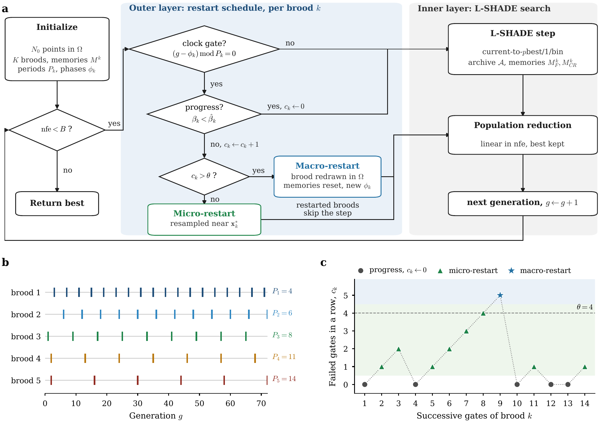</p>
<p align="center"><em><b>Figure 1.</b> Search strategy of CEO: control flow, brood clocks, and failure counter.</em> <a href="figures/Figure_1.pdf">[PDF]</a></p>

<p align="center">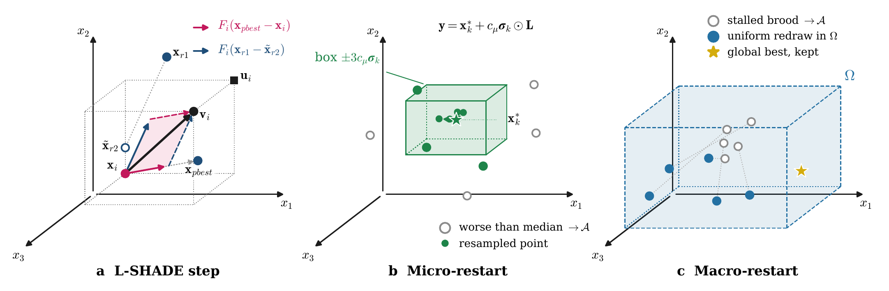</p>
<p align="center"><em><b>Figure 2.</b> Vector view of the L-SHADE step, micro-restart, and macro-restart.</em> <a href="figures/Figure_2.pdf">[PDF]</a></p>

The implementation is `code/ceo_v4.py`, where CEO is registered as `CEO-v4`, the frozen final version; the tuned parameters are in `code/tuned_v4.json`. Every runner has the signature `run(obj, lb, ub, dim, seed, params)`, where `obj` is the budget wrapper of `code/budget.py`:

```python
import json, sys
sys.path.insert(0, "code")
import cec2022_fast as C
from budget import Objective
from ceo_v4 import RUNNERS

f = C.CEC2022Function(1, 10)                # F1 at D = 10
obj = Objective(f, 10, 200_000, f.optimum)   # stops at exactly 200,000 evaluations
params = json.load(open("code/tuned_v4.json"))["CEO-v4"]
RUNNERS["CEO-v4"](obj, -100.0, 100.0, 10, 1, params)
print(obj.error())                            # final error, f(x_best) - f*
```

## Benchmarks
| Suite | Problems | Dimensions | Budget | Runs | Source |
|---|---|---|---|---:|---|
| CEC2022 bound-constrained | 12 functions | 10, 20 | 200,000; 1,000,000 FEs | 30 | official Python code, `code/cec2022_data/` |
| CEC2017 bound-constrained | 29 functions | 10, 30, 50 | 10,000·D FEs | 30 | official C code, `code/cec2017_official/` |
| CEC2020 real-world constrained | RC15 to RC33, 19 mechanical design problems | 2 to 30 | 100,000 FEs, 200,000 for RC16, RC26 and RC33 | 30 | enoppy 0.1.1 for RC15 to RC21, official C++ port for RC22 to RC33, static penalty |
| BBOB noiseless, COCO | 24 functions | 20, 40 | 10,000·D FEs | 30 instances | coco-experiment 2.8.3 |
| Tuning suite | 12 shifted and rotated classical functions | 10 | 100,000 FEs | 3 | `code/tuning_suite.py`, disjoint from all test suites |

## Results
The tables below are generated from the analysis outputs in `code/results/analysis/` and carry the numbering of the paper. Avg. rank is the Friedman rank of the mean errors; Holm *p* is the post-hoc test with CEO as control; W/T/L counts the functions or problems on which CEO is significantly better, not significantly different, or worse. CEO is in the last row of each table.

### Table 4. Twenty swarm algorithms on CEC2022 at D = 10
| Algorithm | Avg. rank | Rank | Holm *p* | W/T/L |
|---|---:|---:|---:|---:|
| MPA | 3.00 | 2 | 1 | 4/5/3 |
| CS | 3.38 | 3 | 1 | 7/2/3 |
| ABC | 4.83 | 4 | 1 | 9/1/2 |
| SMO | 5.62 | 5 | 0.936 | 8/4/0 |
| PSO | 6.38 | 6 | 0.667 | 7/5/0 |
| KH | 6.83 | 7 | 0.545 | 10/0/2 |
| ALO | 8.96 | 8 | 0.0711 | 11/1/0 |
| ACOR | 10.04 | 9 | 0.0203 | 11/1/0 |
| SSA | 10.71 | 10 | 0.00886 | 11/1/0 |
| GWO | 10.92 | 11 | 0.00721 | 12/0/0 |
| FA | 11.67 | 12 | 0.00245 | 12/0/0 |
| MFO | 12.58 | 13 | 5.61E-04 | 12/0/0 |
| WOA | 13.42 | 14 | 1.30E-04 | 12/0/0 |
| DA | 14.25 | 15 | 2.69E-05 | 12/0/0 |
| GOA | 15.75 | 16 | 1.10E-06 | 12/0/0 |
| HHO | 16.50 | 17 | 2.00E-07 | 12/0/0 |
| BA | 16.75 | 18 | 1.15E-07 | 12/0/0 |
| BFO | 17.75 | 19 | 9.50E-09 | 12/0/0 |
| AO | 17.92 | 20 | 6.45E-09 | 12/0/0 |
| CEO | 2.75 | 1 | – | – |

Friedman χ² = 170.6, *p* = 2.1E-26.

### Table 5. Twenty swarm algorithms on RC15 to RC33
| Algorithm | RC15–21 Avg. rank | Holm *p* | W/T/L | RC22–33 Avg. rank | Holm *p* | W/T/L | RC15–33 Avg. rank | Rank | Holm *p* | W/T/L |
|---|---:|---:|---:|---:|---:|---:|---:|---:|---:|---:|
| MPA | 2.36 | 1 | 3/2/2 | 3.42 | 0.535 | 8/3/1 | 3.03 | 2 | 0.688 | 11/5/3 |
| CS | 2.93 | 1 | 3/3/1 | 4.62 | 0.524 | 10/1/1 | 4.00 | 3 | 0.688 | 13/4/2 |
| SMO | 6.36 | 0.961 | 5/2/0 | 6.62 | 0.154 | 11/1/0 | 6.53 | 4 | 0.0711 | 16/3/0 |
| ACOR | 5.29 | 1 | 6/0/1 | 8.08 | 0.0427 | 10/1/1 | 7.05 | 5 | 0.0448 | 16/1/2 |
| ABC | 8.29 | 0.404 | 6/1/0 | 9.00 | 0.0202 | 12/0/0 | 8.74 | 6 | 0.00320 | 18/1/0 |
| GWO | 9.14 | 0.319 | 6/1/0 | 8.67 | 0.0260 | 11/0/1 | 8.84 | 7 | 0.00314 | 17/2/0 |
| ALO | 8.43 | 0.404 | 7/0/0 | 9.54 | 0.0127 | 12/0/0 | 9.13 | 8 | 0.00207 | 19/0/0 |
| PSO | 9.71 | 0.228 | 7/0/0 | 9.42 | 0.0133 | 11/1/0 | 9.53 | 9 | 0.00105 | 18/1/0 |
| FA | 8.71 | 0.384 | 7/0/0 | 10.25 | 0.00504 | 12/0/0 | 9.68 | 10 | 8.40E-04 | 19/0/0 |
| SSA | 11.57 | 0.0475 | 6/1/0 | 11.04 | 0.00158 | 11/1/0 | 11.24 | 11 | 2.40E-05 | 17/2/0 |
| MFO | 13.43 | 0.00777 | 5/2/0 | 11.54 | 7.42E-04 | 10/2/0 | 12.24 | 12 | 1.79E-06 | 15/4/0 |
| DA | 11.86 | 0.0393 | 6/1/0 | 12.54 | 1.52E-04 | 11/1/0 | 12.29 | 13 | 1.68E-06 | 17/2/0 |
| WOA | 14.14 | 0.00387 | 7/0/0 | 11.62 | 6.99E-04 | 11/1/0 | 12.55 | 14 | 8.58E-07 | 18/1/0 |
| KH | 14.14 | 0.00387 | 7/0/0 | 11.75 | 6.08E-04 | 12/0/0 | 12.63 | 15 | 7.34E-07 | 19/0/0 |
| BA | 14.86 | 0.00180 | 7/0/0 | 13.83 | 1.21E-05 | 12/0/0 | 14.21 | 16 | 5.57E-09 | 19/0/0 |
| HHO | 14.71 | 0.00202 | 6/1/0 | 15.17 | 6.58E-07 | 11/1/0 | 15.00 | 17 | 3.91E-10 | 17/2/0 |
| BFO | 15.00 | 0.00158 | 7/0/0 | 17.67 | 1.33E-09 | 12/0/0 | 16.68 | 18 | 7.16E-13 | 19/0/0 |
| AO | 17.57 | 4.23E-05 | 7/0/0 | 16.54 | 2.38E-08 | 12/0/0 | 16.92 | 19 | 2.92E-13 | 19/0/0 |
| GOA | 18.86 | 5.58E-06 | 7/0/0 | 16.75 | 1.47E-08 | 12/0/0 | 17.53 | 20 | 2.50E-14 | 19/0/0 |
| CEO | 2.64 | – | – | 1.92 | – | – | 2.18 | 1 | – | – |

Friedman χ² = 92.1, *p* = 1.4E-11 on RC15 to RC21; χ² = 122.4, *p* = 4.0E-17 on RC22 to RC33; χ² = 208.5, *p* = 6.8E-34 on RC15 to RC33. Rank over all 19 problems. W/T/L from Wilcoxon rank-sum tests per problem, Holm over the problems of each block.

### Table 6. CEO against evolutionary and swarm baselines on CEC2022
| Algorithm | D = 10 Avg. rank | Holm *p* | W/T/L | D = 20 Avg. rank | Holm *p* | W/T/L |
|---|---:|---:|---:|---:|---:|---:|
| jSO | 2.88 | 1 | 2/9/1 | 2.58 | 1 | 1/10/1 |
| L-SHADE | 3.04 | 1 | 4/8/0 | 3.17 | 1 | 1/10/1 |
| DE | 3.38 | 1 | 3/8/1 | 3.79 | 1 | 4/8/0 |
| IPOP-CMA-ES | 3.92 | 1 | 5/6/1 | 3.46 | 1 | 5/5/2 |
| PSO | 5.08 | 0.110 | 7/5/0 | 5.12 | 0.186 | 11/1/0 |
| GWO | 7.00 | 1.54E-04 | 12/0/0 | 7.25 | 1.54E-04 | 12/0/0 |
| HHO | 7.92 | 2.08E-06 | 12/0/0 | 7.58 | 3.91E-05 | 12/0/0 |
| CEO | 2.79 | – | – | 3.04 | – | – |

Friedman χ² = 62.6, *p* = 4.6E-11 at D = 10; χ² = 58.9, *p* = 2.5E-10 at D = 20.

### Table 7. CEO and 17 published methods on RC15 to RC33
| Algorithm | RC15–21 Avg. rank | W/T/L | RC22–33 Avg. rank | W/T/L | RC15–33 Avg. rank | Rank | W/T/L | Feas. rank |
|---|---:|---:|---:|---:|---:|---:|---:|---:|
| *Success-history DE and CMA-ES* |  |  |  |  |  |  |  |  |
| jSO | 4.36 | 0/5/2 | 4.21 | 0/9/3 | 4.26 | 1 | 0/14/5 | 4.05 |
| L-SHADE | 4.29 | 0/5/2 | 4.50 | 0/9/3 | 4.42 | 2 | 0/14/5 | 4.08 |
| DE | 5.00 | 0/5/2 | 5.08 | 1/10/1 | 5.05 | 3 | 1/15/3 | 4.58 |
| LSHADE-cnEpSin | 5.29 | 0/7/0 | 5.12 | 1/8/3 | 5.18 | 4 | 1/15/3 | 4.00 |
| BIPOP-CMA-ES | 5.50 | 0/5/2 | 5.33 | 3/7/2 | 5.39 | 5 | 3/12/4 | 8.21 |
| IMODE | 5.64 | 1/5/1 | 6.54 | 6/5/1 | 6.21 | 7 | 7/10/2 | 5.95 |
| *Swarm intelligence and other metaheuristics* |  |  |  |  |  |  |  |  |
| ACOR | 7.57 | 3/3/1 | 10.38 | 8/3/1 | 9.34 | 8 | 11/6/2 | 10.05 |
| INFO | 8.14 | 3/4/0 | 10.42 | 8/4/0 | 9.58 | 9 | 11/8/0 | 9.29 |
| ABC | 10.36 | 5/2/0 | 12.08 | 10/2/0 | 11.45 | 10 | 15/4/0 | 13.37 |
| HBA | 12.00 | 2/5/0 | 11.83 | 7/5/0 | 11.89 | 11 | 9/10/0 | 9.42 |
| GWO | 12.57 | 5/1/1 | 11.54 | 10/2/0 | 11.92 | 12 | 15/3/1 | 12.53 |
| GA | 14.57 | 7/0/0 | 10.75 | 8/4/0 | 12.16 | 13 | 15/4/0 | 12.82 |
| SCSO | 11.71 | 7/0/0 | 13.21 | 10/2/0 | 12.66 | 14 | 17/2/0 | 12.89 |
| Sawtooth GA | 14.14 | 7/0/0 | 11.83 | 10/2/0 | 12.68 | 15 | 17/2/0 | 13.79 |
| PSO | 13.71 | 6/1/0 | 12.88 | 11/1/0 | 13.18 | 16 | 17/2/0 | 12.16 |
| WOA | 14.71 | 6/1/0 | 14.12 | 9/3/0 | 14.34 | 17 | 15/4/0 | 14.74 |
| HHO | 15.43 | 6/1/0 | 15.88 | 10/2/0 | 15.71 | 18 | 16/3/0 | 15.21 |
| CEO | 6.00 | – | 5.29 | – | 5.55 | 6 | – | 3.87 |

Friedman χ² = 78.4, *p* = 7.2E-10 on RC15 to RC21; χ² = 120.4, *p* = 1.3E-17 on RC22 to RC33; χ² = 191.7, *p* = 1.3E-31 on RC15 to RC33. Avg. rank and Rank: penalized objective, the primary ranking, with all 18 methods ranked together. W/T/L of CEO from paired signed-rank tests per problem over the 30 runs, Holm over the 17 opponents. Feas. rank: average rank under the CEC2020 feasibility rule over the 19 problems, the pre-registered secondary ranking.

### Table 8. Signed-rank and sign tests of CEO against MPA, CS, and ABC
| Cases | MPA B/W/T | SR *p* | Sign *p* | A12 | CS B/W/T | SR *p* | Sign *p* | A12 | ABC B/W/T | SR *p* | Sign *p* | A12 |
|---|---:|---:|---:|---:|---:|---:|---:|---:|---:|---:|---:|---:|
| 82 cases, primary | 55/19/8 | 3.81E-04 | 3.38E-05 | 0.89 | 62/16/4 | 1.33E-05 | 1.51E-07 | 1.00 | 60/18/4 | 1.24E-05 | 1.97E-06 | 1.00 |
| CEC2022, D = 10 | 5/3/4 | 0.844 | 0.727 | 0.50 | 6/4/2 | 0.846 | 0.754 | 0.76 | 8/3/1 | 0.147 | 0.227 | 0.94 |
| CEC2022, D = 20 | 11/1/0 | 0.0161 | 0.00635 | 0.90 | 9/2/1 | 0.175 | 0.0654 | 0.93 | 7/4/1 | 0.413 | 0.549 | 0.98 |
| CEC2017, D = 10 | 13/12/4 | 0.527 | 1 | 0.59 | 20/8/1 | 0.466 | 0.0357 | 1.00 | 20/8/1 | 0.122 | 0.0357 | 1.00 |
| CEC2017, D = 30 | 26/3/0 | 1.03E-05 | 1.52E-05 | 0.97 | 27/2/0 | 9.31E-08 | 1.62E-06 | 1.00 | 25/3/1 | 3.08E-05 | 2.74E-05 | 1.00 |
| CEC2017, D = 50 | 29/0/0 | 1.12E-08 | 3.73E-09 | 1.00 | 28/1/0 | 3.73E-08 | 1.12E-07 | 1.00 | 27/2/0 | 3.73E-08 | 1.62E-06 | 1.00 |
| 70 cases | 50/16/4 | 5.82E-04 | 3.33E-05 | 0.91 | 56/12/2 | 2.32E-05 | 6.21E-08 | 1.00 | 52/15/3 | 2.32E-05 | 6.46E-06 | 1.00 |
| 41 families | 26/4/11 | – | 1.19E-04 | – | 27/4/10 | – | 1.02E-04 | – | 26/5/10 | – | 1.92E-04 | – |

B/W/T counts the cases in which CEO has the lower, higher, or equal mean error. SR *p* is the signed-rank test, Holm-adjusted over the three opponents in the 82-case, 70-case, and D = 50 rows and unadjusted in the four block rows. Sign *p* is unadjusted except in the family row, where it is Holm-adjusted. A12 is the median over the cases of the block. The D = 50 row is the exploratory extension.

### Table 9. CEO and its three closest swarm competitors on CEC2017 and on CEC2022 at D = 20
| Algorithm | CEC2017, D = 10 Rank | Holm *p* | W/T/L | CEC2017, D = 30 Rank | Holm *p* | W/T/L | CEC2017, D = 50 Rank | Holm *p* | W/T/L | CEC2022, D = 20 Rank | Holm *p* | W/T/L |
|---|---:|---:|---:|---:|---:|---:|---:|---:|---:|---:|---:|---:|
| MPA | 1.95 | 0.722 | 13/13/3 | 2.28 | 0.00375 | 26/2/1 | 2.69 | 2.89E-06 | 25/4/0 | 2.83 | 0.0656 | 11/1/0 |
| CS | 3.10 | 0.00684 | 20/7/2 | 3.38 | 2.27E-09 | 27/2/0 | 3.24 | 8.59E-10 | 27/2/0 | 2.88 | 0.0656 | 8/3/1 |
| ABC | 2.88 | 0.0337 | 22/4/3 | 3.05 | 4.27E-07 | 24/2/3 | 2.97 | 7.93E-08 | 25/3/1 | 2.62 | 0.0690 | 8/1/3 |
| CEO | 2.07 | – | – | 1.29 | – | – | 1.10 | – | – | 1.67 | – | – |

### Table 10. CEO against L-SHADE and jSO on CEC2017
| Algorithm | D = 10 Avg. rank | Holm *p* | W/T/L | D = 30 Avg. rank | Holm *p* | W/T/L | D = 50 Avg. rank | Holm *p* | W/T/L |
|---|---:|---:|---:|---:|---:|---:|---:|---:|---:|
| jSO | 1.76 | 0.475 | 3/21/5 | 1.53 | 0.00128 | 0/17/12 | 1.60 | 1.24E-04 | 2/14/13 |
| L-SHADE | 2.17 | 0.694 | 2/25/2 | 2.03 | 0.131 | 0/21/8 | 1.74 | 5.02E-04 | 0/18/11 |
| CEO | 2.07 | – | – | 2.43 | – | – | 2.66 | – | – |

### Table 11. Ablation and replacement controls on CEC2017 at D = 30
| Variant | W/T/L of CEO | Holm *p* |
|---|---:|---:|
| No restart | 4/24/1 | 0.413 |
| No progress gate | 10/19/0 | 1 |
| No macro-restart | 0/29/0 | 1 |
| Shared memory | 3/22/4 | 1 |
| One brood, K = 1 | 12/17/0 | 0.00587 |
| Equal periods | 0/29/0 | 0.392 |
| Gaussian steps | 0/29/0 | 1 |
| Generic restart | 19/10/0 | 1.36E-04 |

Holm *p* is the signed-rank test over the 29 mean errors, adjusted over the eight variants. The code names of the variants in `code/ceo_v4.py` are `v4-noEmergence` No restart, `v4-noGate` No progress gate, `v4-noMacro` No macro-restart, `v4-sharedMem` Shared memory, `v4-K1` One brood, K = 1, `v4-equalPeriods` Equal periods, `v4-gaussMoult` Gaussian steps, `v4-restart` Generic restart.

### Table 13. Six methods on BBOB after equal tuning at D = 30
| Algorithm | D = 20 Avg. rank | CEO *p* | CEO W/T/L | CEO-T *p* | CEO-T W/T/L | D = 40 Avg. rank | CEO *p* | CEO W/T/L | CEO-T *p* | CEO-T W/T/L |
|---|---:|---:|---:|---:|---:|---:|---:|---:|---:|---:|
| jSO | 3.62 | 0.245 | 3/21/0 | 0.972 | 2/21/1 | 2.92 | 0.981 | 5/13/6 | 0.170 | 5/13/6 |
| jSO-T | 4.25 | 0.124 | 6/18/0 | 0.382 | 6/17/1 | 4.17 | 0.398 | 9/10/5 | 0.520 | 8/15/1 |
| L-SHADE | 2.88 | 0.136 | 1/21/2 | 0.00335 | 0/20/4 | 3.02 | 0.227 | 3/12/9 | 0.00378 | 0/15/9 |
| L-SHADE-T | 2.71 | 0.0499 | 1/20/3 | 0.00335 | 0/19/5 | 3.10 | 0.352 | 1/16/7 | 0.0311 | 3/12/9 |
| CEO | 3.67 | – | – | 0.583 | 1/21/2 | 3.85 | – | – | 0.845 | 6/12/6 |
| CEO-T | 3.88 | 0.583 | 2/21/1 | – | – | 3.94 | 0.845 | 6/12/6 | – | – |

*p* is the signed-rank test over the 24 mean errors and W/T/L counts the functions on which CEO or CEO-T is significantly better, equal, or worse than the row; T marks a version tuned on CEC2017 at D = 30. The pre-registered primary test is CEO-T against L-SHADE-T and jSO-T over the 48 cases, see `code/results/analysis/rev2_summary.txt`.

<p align="center">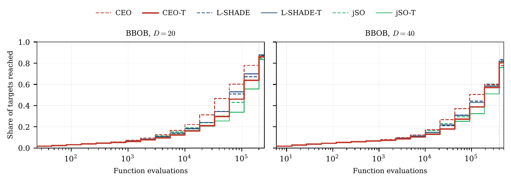</p>
<p align="center"><em><b>Figure 3.</b> Anytime distribution of reached targets on BBOB at D = 20 and D = 40.</em> <a href="figures/Figure_3.pdf">[PDF]</a></p>

### Table 14. Parameter sensitivity of CEO on CEC2017 at D = 10
| N0f (Friedman *p* 0.387) | Rank | B/W | K (Friedman *p* 0.258) | Rank | B/W | E (Friedman *p* 0.00137) | Rank | B/W | θ (Friedman *p* 0.472) | Rank | B/W | cμ (Friedman *p* 6.83E-04) | Rank | B/W | p (Friedman *p* 0.230) | Rank | B/W |
|---|---:|---:|---:|---:|---:|---:|---:|---:|---:|---:|---:|---:|---:|---:|---:|---:|---:|
| 8 | 3.24 | 0/0 | 2 | 3.34 | 1/3 | 10 | 3.59 | 0/8 | 1 | 3.26 | 0/2 | 0.2 | 3.07 | 0/0 | 0.05 | 3.28 | 0/1 |
| 11 | 2.95 | – | 3 | 3.07 | 1/2 | 40 | 2.95 | 0/1 | 2 | 2.91 | 0/0 | 0.273 | 2.76 | – | 0.10 | 3.40 | 0/0 |
| 15 | 2.59 | 1/1 | 5 | 2.52 | – | 78.4 | 2.33 | – | 3 | 3.26 | 0/0 | 0.5 | 2.38 | 0/0 | 0.15 | 2.81 | 0/0 |
| 20 | 3.00 | 2/4 | 6 | 3.03 | 0/0 | 120 | 2.62 | 1/1 | 4 | 2.81 | – | 1 | 2.90 | 0/3 | 0.198 | 2.79 | – |
| 25 | 3.22 | 3/7 | 8 | 3.03 | 0/2 | 200 | 3.52 | 1/5 | 5 | 2.76 | 0/0 | 3 | 3.90 | 0/6 | 0.25 | 2.72 | 0/0 |

Rank is the average Friedman rank of the level over the 29 functions. B/W counts the functions on which the level is significantly better or worse than the frozen level, marked by a dash.

### Table 15. Algorithm complexity (T2 − T1)/T0 on CEC2022 F1
| Algorithm | D = 10 | D = 20 |
|---|---:|---:|
| PSO | 7.31 | 9.12 |
| ACOR | 149.5 | 321.3 |
| ABC | 2.37 | 5.19 |
| GWO | 20.7 | 43.6 |
| WOA | 19.2 | 46.5 |
| HHO | 1.60 | 4.31 |
| FA | 6.33 | 9.71 |
| BA | 6.78 | 7.81 |
| CS | 1.75 | 6.53 |
| BFO | 8.60 | 12.7 |
| DA | 20.3 | 22.2 |
| MFO | -0.75 | 1.38 |
| SMO | 8.24 | 12.0 |
| ALO | 665.7 | 1129.7 |
| SSA | 3.41 | 6.66 |
| GOA | 7.43 | 12.4 |
| MPA | -0.77 | 2.02 |
| KH | 16.1 | 20.4 |
| AO | 1.36 | 3.50 |
| CEO | 1.96 | 3.22 |

Timing depends on the machine; `code/results/complexity.csv` holds the raw times T0, T1 and T2.

### Figures
<p align="center">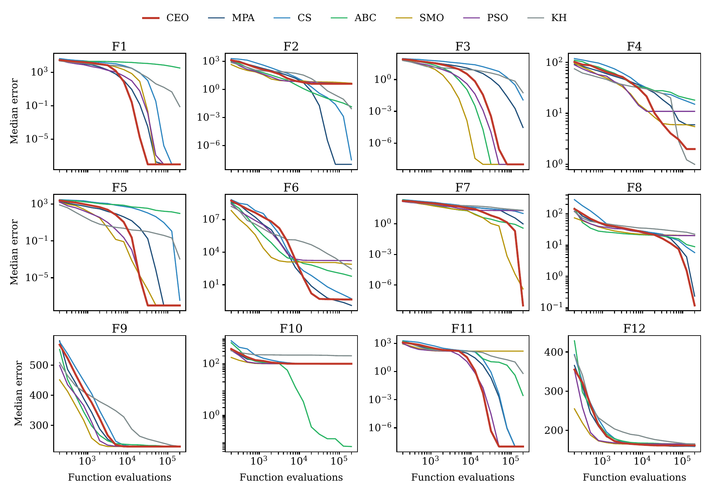</p>
<p align="center"><em><b>Figure 7.</b> Median convergence on CEC2022 at D = 10, CEO and six swarm baselines.</em> <a href="figures/Figure_7.pdf">[PDF]</a></p>

<p align="center">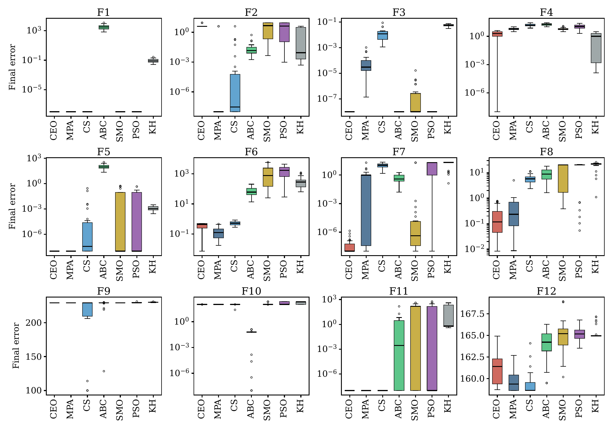</p>
<p align="center"><em><b>Figure 8.</b> Final errors over 30 runs on CEC2022 at D = 10.</em> <a href="figures/Figure_8.pdf">[PDF]</a></p>

<p align="center">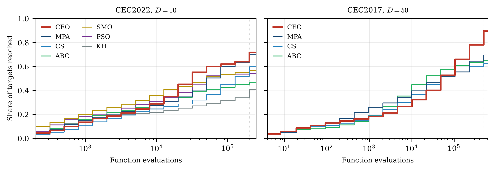</p>
<p align="center"><em><b>Figure 11.</b> Anytime distribution of reached targets on CEC2022 at D = 10 and CEC2017 at D = 50.</em> <a href="figures/Figure_11.pdf">[PDF]</a></p>

<details>
<summary><b>More figures: search behavior and convergence</b></summary>

<p align="center">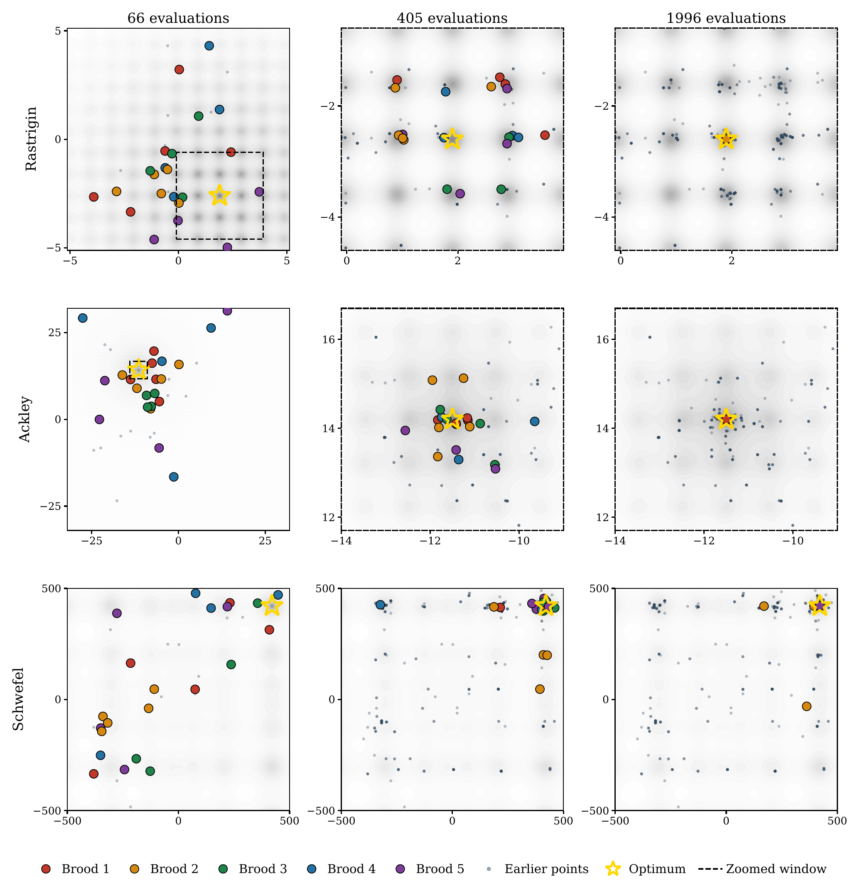</p>
<p align="center"><em><b>Figure 4.</b> Search history of CEO on three 2-D functions, colored by brood. For Rastrigin and Ackley, the second and third columns zoom on the dashed window around the optimum.</em> <a href="figures/Figure_4.pdf">[PDF]</a></p>

<p align="center">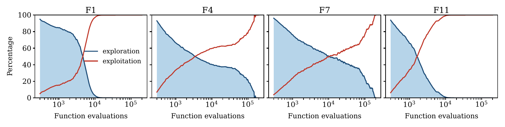</p>
<p align="center"><em><b>Figure 5.</b> Exploration and exploitation of CEO on four CEC2022 functions.</em> <a href="figures/Figure_5.pdf">[PDF]</a></p>

<p align="center">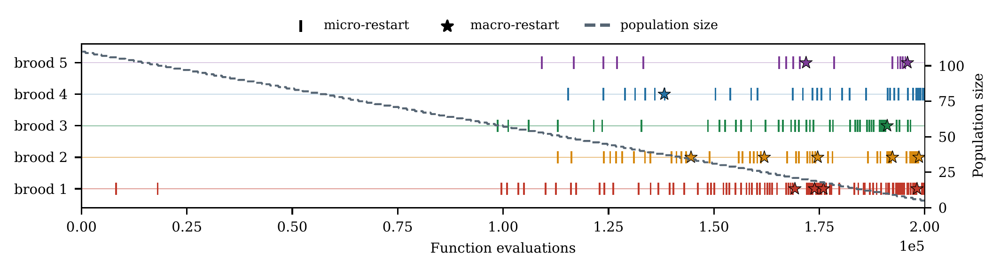</p>
<p align="center"><em><b>Figure 6.</b> Micro- and macro-restarts of each brood in one run on F7.</em> <a href="figures/Figure_6.pdf">[PDF]</a></p>

<p align="center">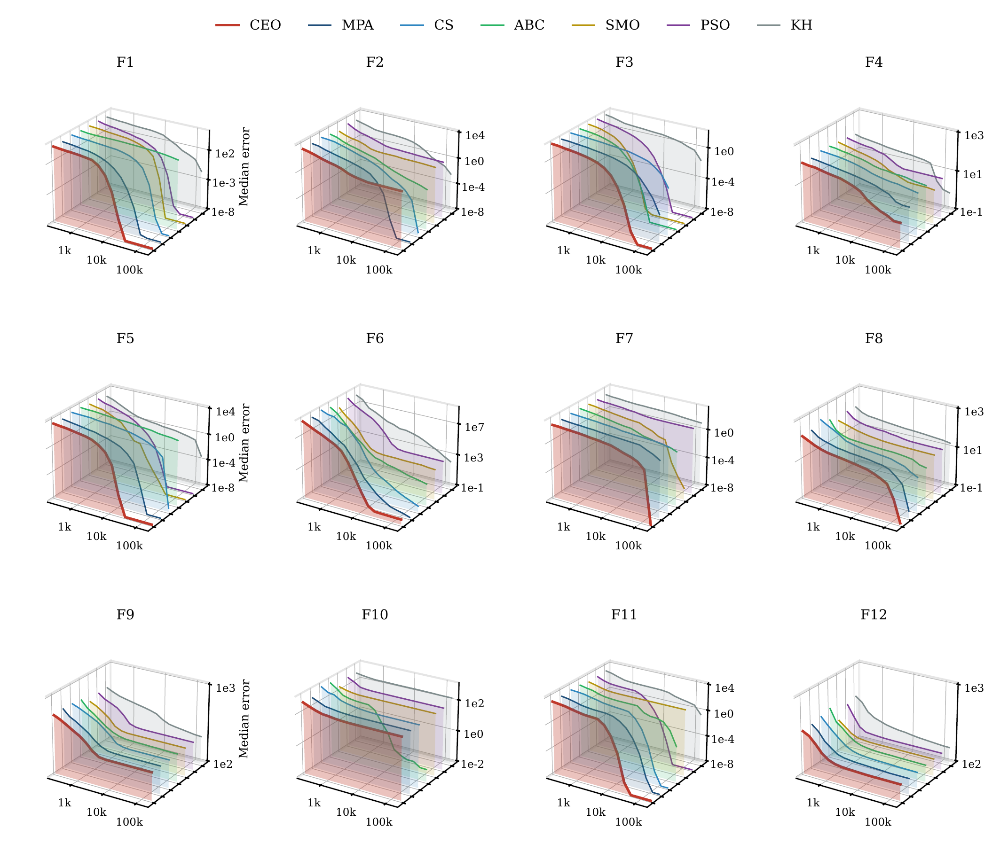</p>
<p align="center"><em><b>Figure 9.</b> Median convergence ribbons on CEC2022 at D = 10.</em> <a href="figures/Figure_9.pdf">[PDF]</a></p>

<p align="center">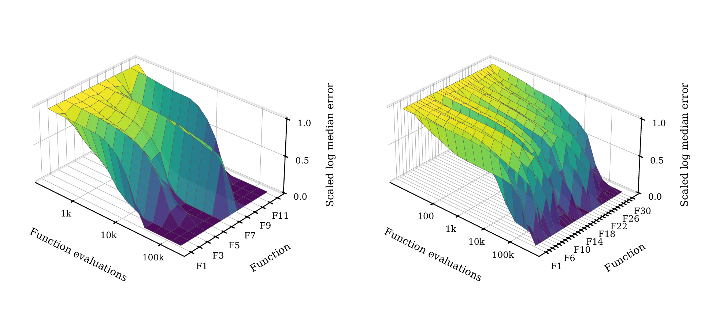</p>
<p align="center"><em><b>Figure 10.</b> Convergence surfaces of CEO on CEC2022 at D = 10, left, and CEC2017 at D = 50, right.</em> <a href="figures/Figure_10.pdf">[PDF]</a></p>

<p align="center">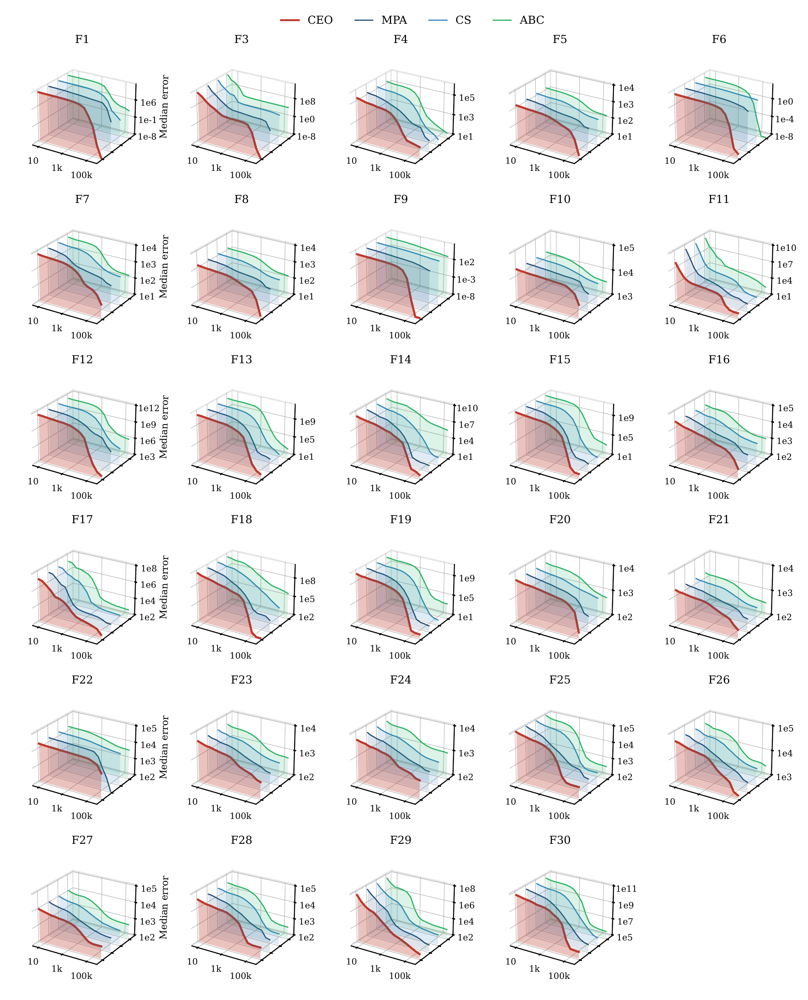</p>
<p align="center"><em><b>Figure S1.</b> Median convergence ribbons on CEC2017 at D = 50.</em> <a href="figures/Figure_S1.pdf">[PDF]</a></p>

</details>

## Reproducing the study
```bash
pip install -r requirements.txt
bash code/run_analysis.sh      # every table of the paper from the saved runs
```
`run_analysis.sh` reads only `runs/` and `code/results/` and writes `code/results/analysis/`. Rerunning the optimizations uses the `run_*.py` scripts and, for RC22 to RC33 and the audited real-world opponents, `experiments/rwx/rwx_runner.py` and `experiments/rwa/rwa_runner.py`; each grid is split into seed shards. The full set of runs takes several hundred core-hours. CEC2017 needs a C++ compiler; the library is built on first use. RC22 to RC33 need the official CEC2020 C++ code, see `experiments/rwx/README.md`.

| Script | Purpose |
|---|---|
| `ceo_v4.py` | The Cicada Emergence Optimizer, CEO, and its ablation and replacement-control variants |
| `budget.py` | Budget wrapper shared by every method; stops a run at exactly B evaluations |
| `baselines.py` | DE, PSO, IPOP-CMA-ES, L-SHADE, jSO, GWO and HHO of the CEC2022 comparison |
| `swarm_orig.py` | Nineteen swarm algorithms written from their original papers, see SWARM_AUDIT.md |
| `cec2022_fast.py` | Adapter for the official CEC2022 Python code, checked bit by bit against it |
| `verify_fast_harness_offline.py` | Check of the CEC2022 adapter against the official reference |
| `tuning_suite.py` | Twelve shifted and rotated classical functions used only for tuning |
| `tune_v4.py` | Tuning of CEO at D = 10 on the tuning suite |
| `run_test_v4.py` | CEO and its ablation on CEC2022 at D = 10 and 20 |
| `run_swarm.py` | Swarm algorithms on CEC2022 at D = 10 |
| `run_rw_v4.py` | CEO on CEC2020 real-world problems RC15 to RC21 |
| `run_rw_swarm.py` | Swarm algorithms on RC15 to RC21 |
| `run_power.py` | Pre-registered CEC2017 study, the D = 50 extension, L-SHADE/jSO and replacement controls |
| `run_sens.py` | Parameter sensitivity on CEC2017 at D = 10 |
| `run_rev2.py` | Equal tuning on CEC2017 at D = 30 and the BBOB test at D = 20 and 40 |
| `select_rev2.py` | Selection of the tuned configurations of the BBOB study |
| `complexity.py` | Algorithm complexity (T2 - T1) / T0 on CEC2022 F1 |
| `analyze_v4.py` | CEC2022 statistics and RC15 to RC21 tests |
| `manuscript_tables.py` | Comparison with evolutionary methods on CEC2022 and the D = 10 ablation |
| `analyze_swarm.py` | Twenty swarm algorithms on CEC2022 and RC15 to RC21 |
| `analyze_power.py` | Pre-registered primary test over 82 function-dimension cases |
| `analyze_power50.py` | Exploratory CEC2017 extension at D = 50 |
| `analyze_sens.py` | Parameter sensitivity table |
| `analyze_rev1_b.py` | Primary test per block and per function family |
| `analyze_rev1_c.py` | L-SHADE and jSO on CEC2017, ablation at D = 30, fixed initial population |
| `analyze_rev2.py` | BBOB study after equal tuning |
| `analyze_rev3.py` | Gates per brood, paired BBOB tests, RC15 to RC21 feasibility, timing variation |
| `analyze_rw_audited.py` | CEO and the 16 published methods on RC15 to RC21, audited swarm versions |
| `analyze_table_cells.py` | Remaining table cells: A12 and 70-case sign tests, CEO against the tuned BBOB methods |
| `rw_evo_audited.py` | Audited ports of L-SHADE, LSHADE-cnEpSin, IMODE, INFO, HBA and SCSO for RC15 to RC33, see RW_EVO_AUDIT.md |
| `analyze_rw19.py` | Twenty swarm algorithms on RC15 to RC33 per block, feasibility and the feasibility-rule ranking |
| `analyze_rw_d1d2.py` | CEO and the 17 published methods on RC15 to RC33 with the audited ports, superseded versions |
| `feas_rank_audited.py` | Ranking under the CEC2020 feasibility rule for the 18 methods on RC15 to RC33 |
| `make_supp_rw_tables.py` | Rows of Supplementary Tables S1 to S6 and S10, feasibility and objective on RC15 to RC33 |
| `experiments/` | Harness and published methods of the real-world comparison: `r1/r1_lib.py` for RC15 to RC21, `rwx/` for RC22 to RC33, `rwa/` for the audited opponents |

## Repository layout
```
code/                 algorithms, benchmark adapters, run and analysis scripts, SWARM_AUDIT.md, RW_EVO_AUDIT.md
  cec2022_data/       official CEC2022 Python code and input data
  cec2017_official/   official CEC2017 C code and input data
  third_party/evolopy/ WOA of EvoloPy, used verbatim (Apache-2.0)
  results/            RC15 to RC21 runs, tuning, timing, figure source data
    analysis/         every analysis table and summary of the paper; rw19/ and rw19_audited/ for RC15 to RC33
experiments/          harness of the real-world comparison and the published methods; rwx/, rwa/ for RC22 to RC33
runs/                 per-run results, final errors and errors at the CEC recording points
figures/              figures of the paper, vector PDF; png/ holds 300-dpi copies shown on this page
```

| Folder | Runs |
|---|---|
| `runs/v4/` | CEO, its D = 10 ablation and the superseded first design on CEC2022 at D = 10 and 20 |
| `runs/swarm/` | Nineteen swarm algorithms on CEC2022 at D = 10 |
| `runs/power/` | Pre-registered study: CEO, MPA, CS and ABC on CEC2017 at D = 10, 30 and CEC2022 at D = 20 |
| `runs/power50/` | Exploratory CEC2017 extension at D = 50 |
| `runs/power50t/` | Convergence traces on CEC2017 at D = 50 |
| `runs/rev1/` | L-SHADE, jSO, replacement controls and the fixed initial population on CEC2017 |
| `runs/rev2t/` | Tuning stage of the BBOB study on CEC2017 at D = 30 |
| `runs/rev2b/` | BBOB test at D = 20 and 40 |
| `runs/sens/` | Parameter sensitivity on CEC2017 at D = 10 |
| `runs/r1/` | Published methods on RC15 to RC21, library versions; the superseded ones are listed in Table S10 |
| `runs/rwa/` | Audited L-SHADE, DE, LSHADE-cnEpSin, IMODE and jSO on RC15 to RC33 |
| `runs/rwb/` | Audited INFO, HBA and SCSO on RC15 to RC33, with the rerun of HBA on RC20 |
| `runs/rwx/` | CEO, 19 swarm algorithms and ten published methods on RC22 to RC33, `rwx_all.csv` |
| `runs/baselines_cec2022/` | DE, PSO, IPOP-CMA-ES, L-SHADE, jSO, GWO and HHO on CEC2022 at D = 10 and 20, same harness and seeds |

## Data and license
All benchmark suites are public: CEC2017 and CEC2022 through the official code of the competition organizers, RC15 to RC33 from the CEC2020 constrained real-world collection, Kumar et al., Swarm Evol. Comput. 56 (2020) 100693, and BBOB through the COCO platform, Hansen et al., Optim. Methods Softw. 36 (2021) 114–144. The code is released under the MIT License; `code/third_party/evolopy/` keeps its Apache-2.0 license. The C++ port of the CEC2020 real-world code is GPL-3 and is therefore not included.

## Citation
The article has been submitted to *Expert Systems with Applications*. Until it is published, please cite this repository; see `CITATION.cff`.

## Contact
<sup>a</sup> Faculty of Information Technology, Posts and Telecommunications Institute of Technology, 11 Nguyen Dinh Chieu Street, Sai Gon Ward, Ho Chi Minh City 700000, Vietnam<br>
<sup>b</sup> Faculty of Information Technology and Digital Innovation, King Mongkut's University of Technology North Bangkok, 1518 Pracharat 1 Road, Wongsawang, Bang Sue, Bangkok 10800, Thailand<br>
<sup>&#42;</sup> Corresponding author: Phayung Meesad, phayung.m@itd.kmutnb.ac.th
