<div align="center">

# Cicada Emergence Optimizer (CEO)

### Cicada Emergence Optimizer: An Ablation Study of Brood Restarts in Differential Evolution

**Van Van Chau**<sup>1,2</sup> · **Minh Tuan Nguyen**<sup>1</sup> · **Phayung Meesad**<sup>2,*</sup>

<sup>1</sup> Faculty of Information Technology, Posts and Telecommunications Institute of Technology, Ho Chi Minh City, Vietnam<br>
<sup>2</sup> Department of Information Technology Management, King Mongkut's University of Technology North Bangkok, Bangkok, Thailand<br>
<sup>*</sup> Corresponding author: phayung.m@itd.kmutnb.ac.th

*Swarm and Evolutionary Computation* (submitted)

  

</div>

---

## Contents
[Abstract](#abstract) · [Contributions](#contributions) · [The algorithm](#the-algorithm) · [Benchmarks](#benchmarks) · [Results](#results) · [Reproducing the study](#reproducing-the-study) · [Repository layout](#repository-layout) · [Citation](#citation)

## Abstract
Few nature-inspired optimizers test whether their metaphor matters. We propose a new algorithm, the Cicada Emergence Optimizer, CEO, and measure what each borrowed part does. CEO is L-SHADE with its population split into broods that keep their own success memories and check their progress on staggered clocks. A stalled brood is resampled around its best member or, after repeated failures, redrawn over the whole domain. Among 20 swarm-intelligence algorithms, each checked against its original paper, CEO ranked first on CEC2022 and in the top three on seven CEC2020 real-world problems. A pre-registered test over 82 function-dimension cases found it significantly better than the marine predators algorithm, cuckoo search and artificial bee colony, and an exploratory extension to CEC2017 at dimension D = 50 pointed the same way. Against its parents the result is negative. No significant difference from L-SHADE and jSO was detected on CEC2022 and on CEC2017 at D = 10, but CEO was significantly worse than both at D = 30 and D = 50. In an ablation at D = 30, CEO was significantly better than a single brood and a generic stagnation restart. The progress check won ten functions without a loss but was not significant in aggregate, and equal periods and Gaussian steps showed no significant effect. On the unseen BBOB suite, the frozen CEO showed no significant difference from the published L-SHADE and jSO and led the early part of the full-budget runs. After equal tuning of all three at D = 30, the tuned CEO was significantly worse than the tuned L-SHADE.

**Keywords:** metaheuristic · swarm intelligence · periodical cicada · multi-population search · differential evolution · ablation study

## Contributions
1. **A new optimizer.** CEO is L-SHADE with its population split into broods. Each brood keeps its own success memory and checks its progress at gates of its own clock. A stalled brood is resampled around its best member, micro-emergence, and after repeated failures redrawn over the whole domain, macro-emergence.
2. **Audited baselines.** All 19 swarm algorithms were written from their original papers and checked against the published equations and the authors' code; `code/SWARM_AUDIT.md` lists every check and the library defects found.
3. **Pre-registered tests.** The main tests were fixed in dated protocols before the runs; the protocol files with their lists of deviations are in `code/PROTOCOL_*.md` and `experiments/r1/PROTOCOL_R1.md`.
4. **Ablation with replacement controls** that separates the brood restarts from a single brood and a generic stagnation restart.
5. **Every loss reported.** CEO trails L-SHADE and jSO from D = 30 on CEC2017 and the tuned L-SHADE on BBOB; these results are reported with the wins.

## The algorithm
<p align="center">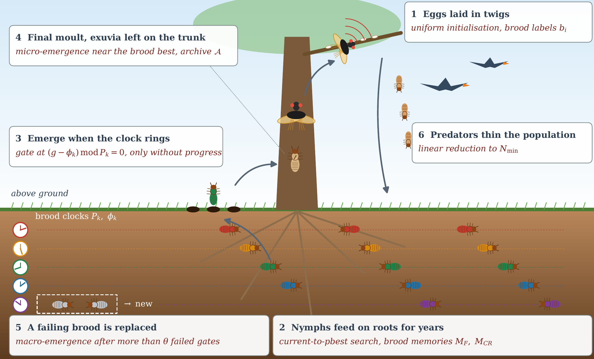</p>
<p align="center"><em><b>Figure 1.</b> Periodical-cicada life cycle and CEO operator behind each stage.</em> <a href="figures/Fig1_lifecycle.pdf">[PDF]</a></p>

<p align="center">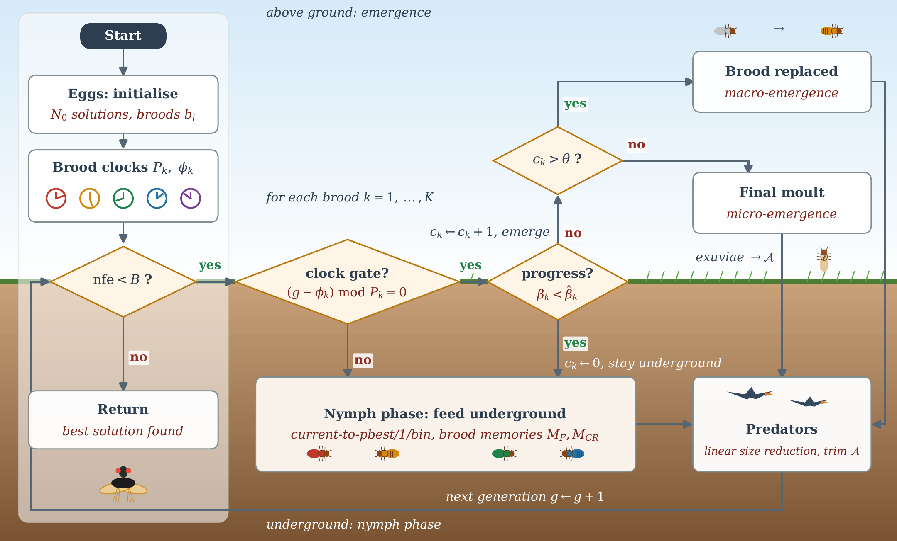</p>
<p align="center"><em><b>Figure 2.</b> Control flow of CEO, drawn above and below the soil line.</em> <a href="figures/Fig2_flowchart.pdf">[PDF]</a></p>

<p align="center">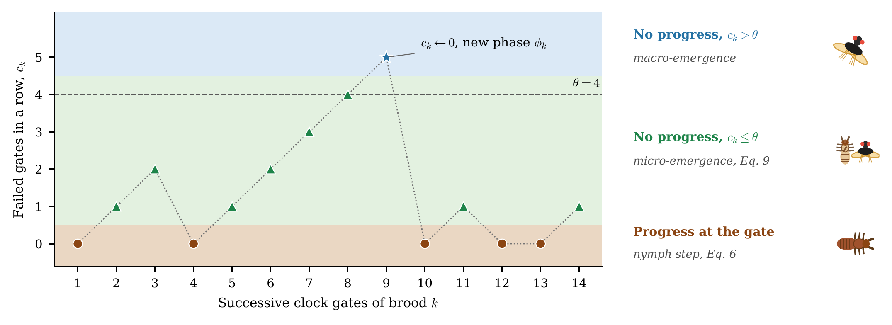</p>
<p align="center"><em><b>Figure 3.</b> Operator chosen by brood k at successive clock gates, with θ = 4.</em> <a href="figures/Fig3_strategy.pdf">[PDF]</a></p>

<p align="center">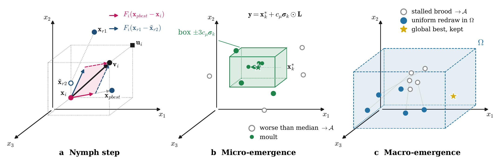</p>
<p align="center"><em><b>Figure 4.</b> Vector view of the nymph step, micro-emergence and macro-emergence.</em> <a href="figures/Fig4_vectors.pdf">[PDF]</a></p>

The implementation is `code/ceo_v4.py`; the tuned parameters are in `code/tuned_v4.json`. Every runner has the signature `run(obj, lb, ub, dim, seed, params)`, where `obj` is the budget wrapper of `code/budget.py`:

```python
import json, sys
sys.path.insert(0, "code")
import cec2022_fast as C
from budget import Objective
from ceo_v4 import RUNNERS

f = C.CEC2022Function(1, 10)                # F1 at D = 10
obj = Objective(f, 10, 200_000, f.optimum)   # stops at exactly 200,000 evaluations
params = json.load(open("code/tuned_v4.json"))["CEO-v4"]
RUNNERS["CEO-v4"](obj, -100.0, 100.0, 10, 1, params)
print(obj.error())                            # final error, f(x_best) - f*
```

## Benchmarks
| Suite | Problems | Dimensions | Budget | Runs | Source |
|---|---|---|---|---:|---|
| CEC2022 bound-constrained | 12 functions | 10, 20 | 200,000; 1,000,000 FEs | 30 | official Python code, `code/cec2022_data/` |
| CEC2017 bound-constrained | 29 functions | 10, 30, 50 | 10,000·D FEs | 30 | official C code, `code/cec2017_official/` |
| CEC2020 real-world constrained | RC15 to RC21 | 4 to 9 | 100,000 FEs, 200,000 for RC16 | 30 | enoppy 0.1.1, static penalty |
| BBOB noiseless, COCO | 24 functions | 20, 40 | 10,000·D FEs | 30 instances | coco-experiment 2.8.3 |
| Tuning suite | 12 shifted and rotated classical functions | 10 | 100,000 FEs | 3 | `code/tuning_suite.py`, disjoint from all test suites |

## Results
Avg. rank is the Friedman rank of the mean errors; Holm *p* is the post-hoc test with CEO as control; W/T/L counts the functions or problems on which CEO is significantly better, not significantly different or worse. CEO is in the last row of each table.

### Twenty swarm algorithms on CEC2022 at D = 10
| Algorithm | Avg. rank | Rank | Holm *p* | W/T/L |
|---|---:|---:|---:|---:|
| MPA | 3.00 | 2 | 1 | 4/5/3 |
| CS | 3.38 | 3 | 1 | 7/2/3 |
| ABC | 4.83 | 4 | 1 | 9/1/2 |
| SMO | 5.62 | 5 | 0.936 | 8/4/0 |
| PSO | 6.38 | 6 | 0.667 | 7/5/0 |
| KH | 6.83 | 7 | 0.545 | 10/0/2 |
| ALO | 8.96 | 8 | 0.0711 | 11/1/0 |
| ACOR | 10.04 | 9 | 0.0203 | 11/1/0 |
| SSA | 10.71 | 10 | 0.00886 | 11/1/0 |
| GWO | 10.92 | 11 | 0.00721 | 12/0/0 |
| FA | 11.67 | 12 | 0.00245 | 12/0/0 |
| MFO | 12.58 | 13 | 5.61E-04 | 12/0/0 |
| WOA | 13.42 | 14 | 1.30E-04 | 12/0/0 |
| DA | 14.25 | 15 | 2.69E-05 | 12/0/0 |
| GOA | 15.75 | 16 | 1.10E-06 | 12/0/0 |
| HHO | 16.50 | 17 | 2.00E-07 | 12/0/0 |
| BA | 16.75 | 18 | 1.15E-07 | 12/0/0 |
| BFO | 17.75 | 19 | 9.50E-09 | 12/0/0 |
| AO | 17.92 | 20 | 6.45E-09 | 12/0/0 |
| CEO | 2.75 | 1 | – | – |

Friedman χ² = 170.6, *p* = 2.1E-26; equal average ranks share the mean rank.

### Twenty swarm algorithms on RC15 to RC21
| Algorithm | Avg. rank | Rank | Holm *p* | W/T/L |
|---|---:|---:|---:|---:|
| MPA | 2.36 | 1 | 1 | 3/2/2 |
| CS | 2.93 | 3 | 1 | 3/3/1 |
| ACOR | 5.29 | 4 | 1 | 6/0/1 |
| SMO | 6.36 | 5 | 0.961 | 5/2/0 |
| ABC | 8.29 | 6 | 0.404 | 6/1/0 |
| ALO | 8.43 | 7 | 0.404 | 7/0/0 |
| FA | 8.71 | 8 | 0.384 | 7/0/0 |
| GWO | 9.14 | 9 | 0.319 | 6/1/0 |
| PSO | 9.71 | 10 | 0.228 | 7/0/0 |
| SSA | 11.57 | 11 | 0.0475 | 6/1/0 |
| DA | 11.86 | 12 | 0.0393 | 6/1/0 |
| MFO | 13.43 | 13 | 0.00777 | 5/2/0 |
| WOA | 14.14 | 14.5 | 0.00387 | 7/0/0 |
| KH | 14.14 | 14.5 | 0.00387 | 7/0/0 |
| HHO | 14.71 | 16 | 0.00202 | 6/1/0 |
| BA | 14.86 | 17 | 0.00180 | 7/0/0 |
| BFO | 15.00 | 18 | 0.00158 | 7/0/0 |
| AO | 17.57 | 19 | 4.23E-05 | 7/0/0 |
| GOA | 18.86 | 20 | 5.58E-06 | 7/0/0 |
| CEO | 2.64 | 2 | – | – |

Friedman χ² = 92.1, *p* = 1.4E-11; equal average ranks share the mean rank.

<p align="center">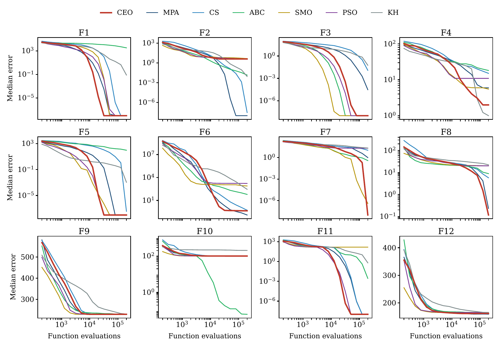</p>
<p align="center"><em><b>Figure 5.</b> Median convergence on CEC2022 at D = 10, CEO and six swarm baselines.</em> <a href="figures/Fig9_convergence_cec2022.pdf">[PDF]</a></p>

<p align="center">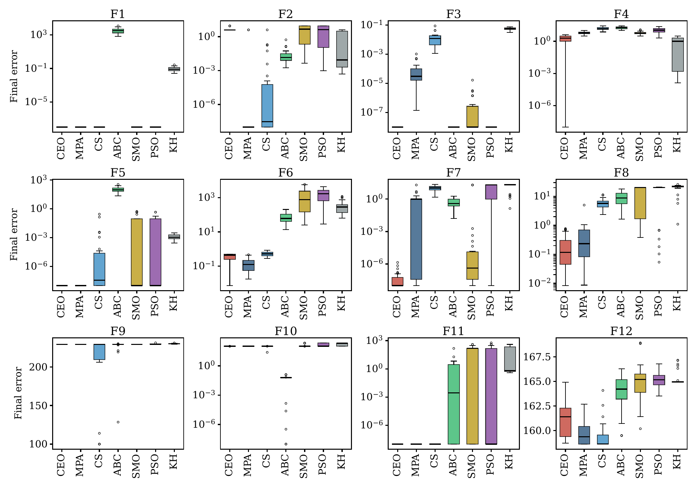</p>
<p align="center"><em><b>Figure 6.</b> Final errors over 30 runs on CEC2022 at D = 10.</em> <a href="figures/Fig10_box_cec2022.pdf">[PDF]</a></p>

### CEO against evolutionary and swarm baselines on CEC2022
| Algorithm | Avg. rank, D = 10 | Holm *p*, D = 10 | W/T/L, D = 10 | Avg. rank, D = 20 | Holm *p*, D = 20 | W/T/L, D = 20 |
|---|---:|---:|---:|---:|---:|---:|
| jSO | 2.88 | 1 | 2/9/1 | 2.58 | 1 | 1/10/1 |
| L-SHADE | 3.04 | 1 | 4/8/0 | 3.17 | 1 | 1/10/1 |
| DE | 3.38 | 1 | 3/8/1 | 3.79 | 1 | 4/8/0 |
| IPOP-CMA-ES | 3.92 | 1 | 5/6/1 | 3.46 | 1 | 5/5/2 |
| PSO | 5.08 | 0.110 | 7/5/0 | 5.12 | 0.186 | 11/1/0 |
| GWO | 7.00 | 1.54E-04 | 12/0/0 | 7.25 | 1.54E-04 | 12/0/0 |
| HHO | 7.92 | 2.08E-06 | 12/0/0 | 7.58 | 3.91E-05 | 12/0/0 |
| CEO | 2.79 | – | – | 3.04 | – | – |

Friedman χ² = 62.6, *p* = 4.6E-11 at D = 10; Friedman χ² = 58.9, *p* = 2.5E-10 at D = 20.

### CEO and 16 published methods on RC15 to RC21
| Algorithm | Avg. rank | Rank | W/T/L |
|---|---:|---:|---:|
| LSHADE-cnEpSin | 3.43 | 1 | 0/5/2 |
| L-SHADE | 3.86 | 2 | 1/5/1 |
| IMODE | 4.14 | 3 | 0/6/1 |
| BIPOP-CMA-ES | 4.43 | 4 | 0/5/2 |
| ACOR | 6.36 | 6 | 3/3/1 |
| DE | 6.93 | 7 | 1/4/2 |
| ABC | 9.21 | 8 | 5/2/0 |
| HBA | 9.79 | 9 | 6/1/0 |
| GWO | 10.71 | 10 | 5/1/1 |
| SCSO | 10.86 | 11 | 6/1/0 |
| INFO | 12.29 | 12.5 | 7/0/0 |
| PSO | 12.29 | 12.5 | 6/1/0 |
| Sawtooth GA | 13.00 | 14 | 7/0/0 |
| GA | 13.29 | 15 | 7/0/0 |
| WOA | 13.36 | 16 | 6/1/0 |
| HHO | 14.21 | 17 | 6/1/0 |
| CEO | 4.86 | 5 | – |

Friedman χ² = 69.7, *p* = 1.1E-08. W/T/L from paired signed-rank tests per problem over the 30 runs, Holm over the 16 opponents. Equal average ranks share the mean rank.

### Pre-registered test against MPA, CS and ABC
| Cases | Opponent | CEO better/worse/tie | Signed-rank Holm *p* | Sign test *p* |
|---|---|---:|---:|---:|
| 82 cases | MPA | 55/19/8 | 3.81E-04 | 3.38E-05 |
| 82 cases | CS | 62/16/4 | 1.33E-05 | 1.51E-07 |
| 82 cases | ABC | 60/18/4 | 1.24E-05 | 1.97E-06 |
| CEC2017, D = 50 | MPA | 29/0/0 | 1.12E-08 | 3.73E-09 |
| CEC2017, D = 50 | CS | 28/1/0 | 3.73E-08 | 1.12E-07 |
| CEC2017, D = 50 | ABC | 27/2/0 | 3.73E-08 | 1.62E-06 |

The primary test pools CEC2022 at D = 10 and 20 and CEC2017 at D = 10 and 30, 82 function-dimension cases, Holm over the three opponents. CEC2017 at D = 50 is an exploratory extension tested on its own.

### CEO against L-SHADE and jSO on CEC2017
| Algorithm | Avg. rank, D = 10 | Holm *p*, D = 10 | W/T/L, D = 10 | Avg. rank, D = 30 | Holm *p*, D = 30 | W/T/L, D = 30 | Avg. rank, D = 50 | Holm *p*, D = 50 | W/T/L, D = 50 |
|---|---:|---:|---:|---:|---:|---:|---:|---:|---:|
| jSO | 1.76 | 0.475 | 3/21/5 | 1.53 | 0.00128 | 0/17/12 | 1.60 | 1.24E-04 | 2/14/13 |
| L-SHADE | 2.17 | 0.694 | 2/25/2 | 2.03 | 0.131 | 0/21/8 | 1.74 | 5.02E-04 | 0/18/11 |
| CEO | 2.07 | – | – | 2.43 | – | – | 2.66 | – | – |

### Ablation and replacement controls on CEC2017 at D = 30
| Variant | W/T/L of CEO | Holm *p* |
|---|---:|---:|
| No emergence | 4/24/1 | 0.413 |
| No progress gate | 10/19/0 | 1 |
| No macro-emergence | 0/29/0 | 1 |
| Shared memory | 3/22/4 | 1 |
| One brood, K = 1 | 12/17/0 | 0.00587 |
| Equal periods | 0/29/0 | 0.392 |
| Gaussian moults | 0/29/0 | 1 |
| Generic restart | 19/10/0 | 1.36E-04 |

Holm *p* is the signed-rank test over the 29 mean errors, adjusted over the eight variants.

### BBOB after equal tuning at D = 30
| Pair | *p*, D = 20 | W/T/L, D = 20 | *p*, D = 40 | W/T/L, D = 40 |
|---|---:|---:|---:|---:|
| CEO-T vs. L-SHADE-T | 0.00335 | 0/19/5 | 0.0311 | 3/12/9 |
| CEO-T vs. jSO-T | 0.382 | 6/17/1 | 0.520 | 8/15/1 |
| CEO vs. L-SHADE | 0.136 | 1/21/2 | 0.227 | 3/12/9 |
| CEO vs. jSO | 0.245 | 3/21/0 | 0.981 | 5/13/6 |
| CEO-T vs. CEO | 0.583 | 1/21/2 | 0.845 | 6/12/6 |

*p* is the signed-rank test over the 24 mean errors; T marks a version tuned on CEC2017 at D = 30. The pre-registered primary test is CEO-T against L-SHADE-T and jSO-T.

<p align="center">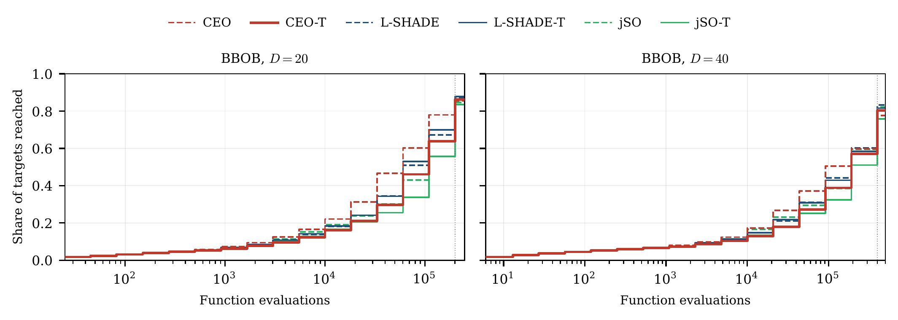</p>
<p align="center"><em><b>Figure 7.</b> Anytime distribution of reached targets on BBOB at D = 20 and D = 40.</em> <a href="figures/Fig5_ecdf_bbob.pdf">[PDF]</a></p>

<p align="center">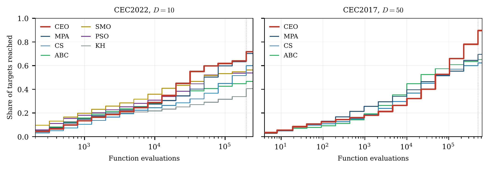</p>
<p align="center"><em><b>Figure 8.</b> Anytime distribution of reached targets on CEC2022 at D = 10 and CEC2017 at D = 50.</em> <a href="figures/Fig13_ecdf.pdf">[PDF]</a></p>

<details>
<summary><b>More figures: search behavior and convergence</b></summary>

<p align="center">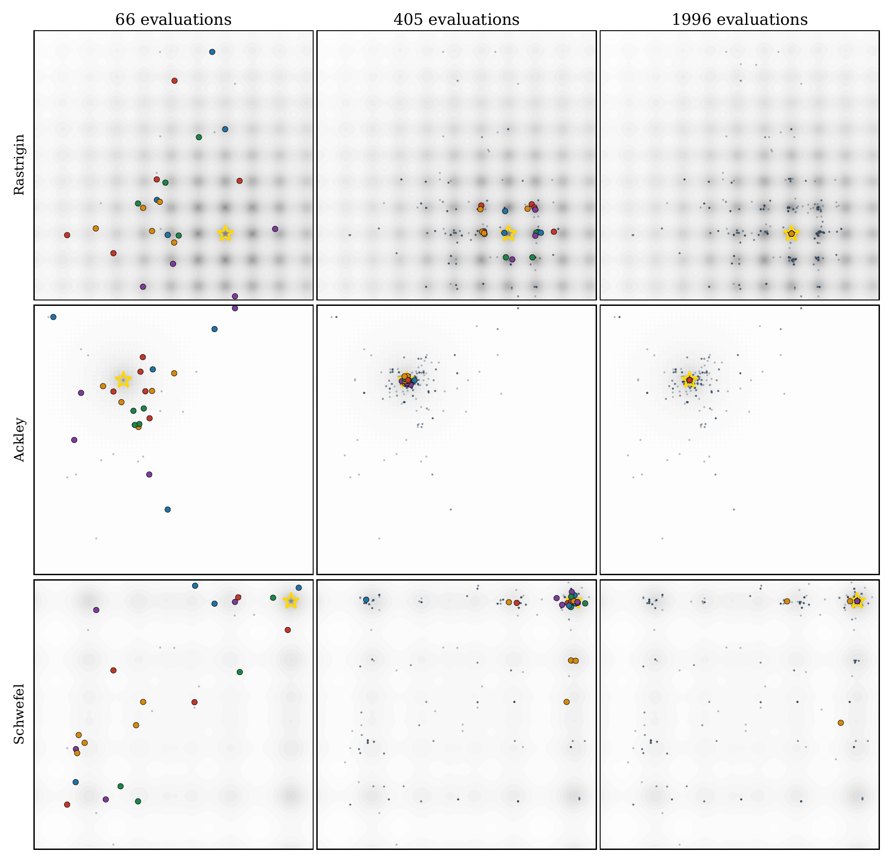</p>
<p align="center"><em><b>Figure 9.</b> Search history of CEO on three 2-D functions, colored by brood.</em> <a href="figures/Fig6_search2d.pdf">[PDF]</a></p>

<p align="center">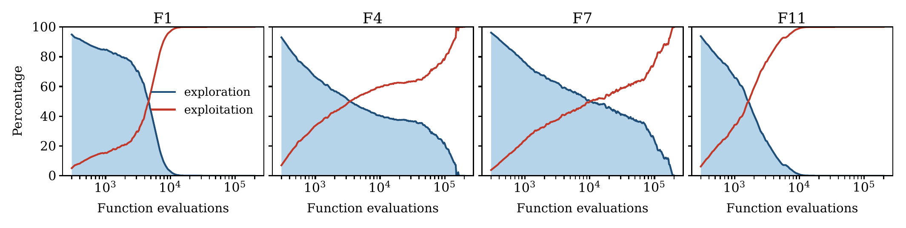</p>
<p align="center"><em><b>Figure 10.</b> Exploration and exploitation of CEO on four CEC2022 functions.</em> <a href="figures/Fig7_exploration.pdf">[PDF]</a></p>

<p align="center">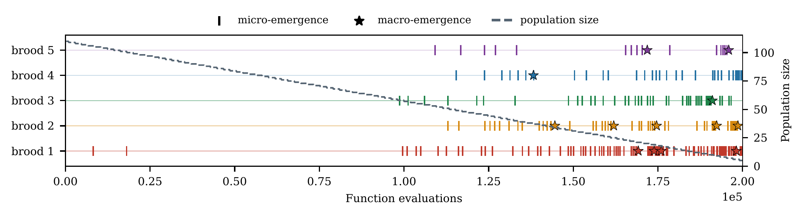</p>
<p align="center"><em><b>Figure 11.</b> Micro- and macro-emergences of each brood in one run on F7.</em> <a href="figures/Fig8_emergence.pdf">[PDF]</a></p>

<p align="center">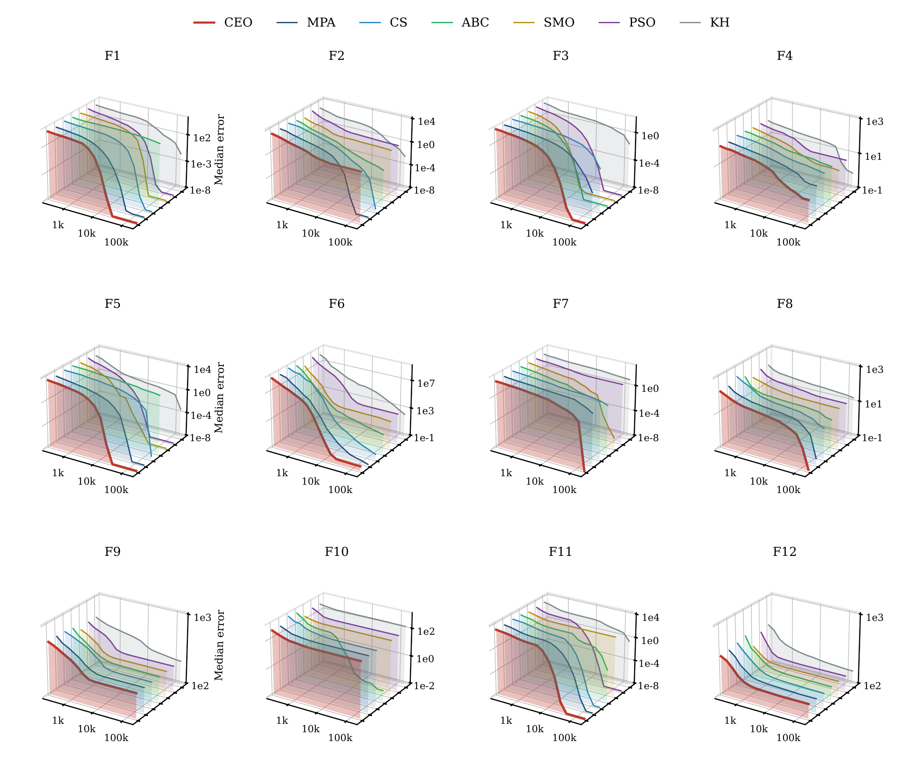</p>
<p align="center"><em><b>Figure 12.</b> Median convergence ribbons on CEC2022 at D = 10.</em> <a href="figures/Fig11_convergence3d_cec2022.pdf">[PDF]</a></p>

<p align="center">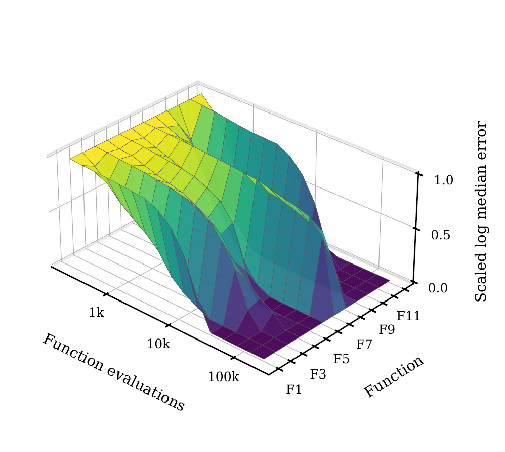</p>
<p align="center"><em><b>Figure 13a.</b> Convergence surface of CEO on CEC2022 at D = 10.</em> <a href="figures/Fig12a_surface3d_cec2022.pdf">[PDF]</a></p>

<p align="center">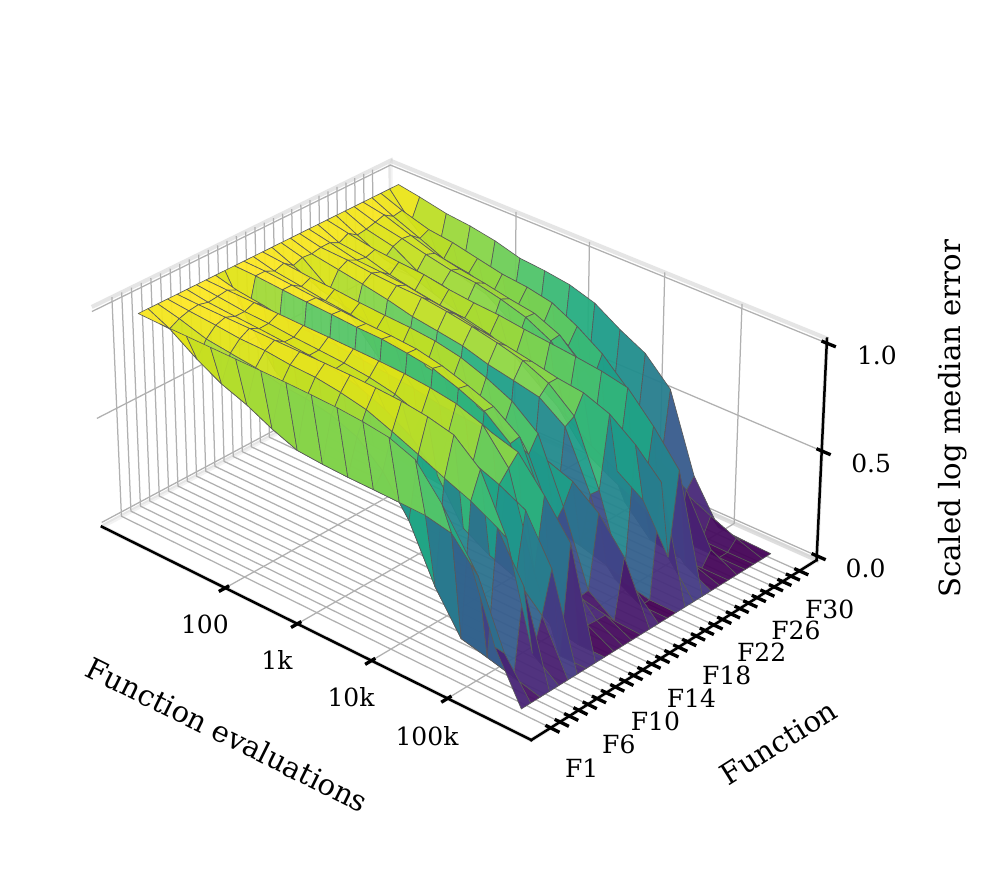</p>
<p align="center"><em><b>Figure 13b.</b> Convergence surface of CEO on CEC2017 at D = 50.</em> <a href="figures/Fig12b_surface3d_cec2017_d50.pdf">[PDF]</a></p>

<p align="center">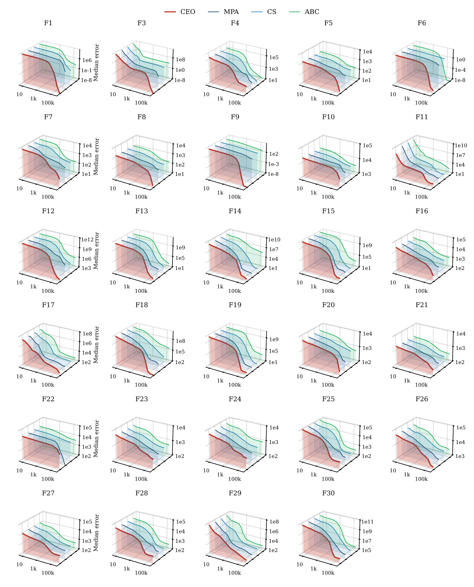</p>
<p align="center"><em><b>Figure S1.</b> Median convergence ribbons on CEC2017 at D = 50.</em> <a href="figures/FigS1_convergence3d_cec2017_d50.pdf">[PDF]</a></p>

</details>

## Reproducing the study
```bash
pip install -r requirements.txt
bash code/run_analysis.sh      # every table of the paper from the saved runs, a few minutes
```
`run_analysis.sh` reads only `runs/` and `code/results/` and writes `code/results/analysis/`. Rerunning the optimizations uses the `run_*.py` scripts, which split each grid into seed shards, for example `python code/run_power.py --shard 0 --nshards 8 --outdir out`. The full set of runs takes several hundred core-hours. CEC2017 needs a C++ compiler; the library is built on first use.

| Script | Purpose |
|---|---|
| `ceo_v4.py` | The Cicada Emergence Optimizer, CEO, and its ablation and replacement-control variants |
| `budget.py` | Budget wrapper shared by every method; stops a run at exactly B evaluations |
| `baselines.py` | DE, PSO, IPOP-CMA-ES, L-SHADE, jSO, GWO and HHO of the CEC2022 comparison |
| `swarm_orig.py` | Nineteen swarm algorithms written from their original papers, see SWARM_AUDIT.md |
| `cec2022_fast.py` | Adapter for the official CEC2022 Python code, checked bit by bit against it |
| `verify_fast_harness_offline.py` | Check of the CEC2022 adapter against the official reference |
| `tuning_suite.py` | Twelve shifted and rotated classical functions used only for tuning |
| `tune_v4.py` | Tuning of CEO at D = 10 on the tuning suite |
| `run_test_v4.py` | CEO and its ablation on CEC2022 at D = 10 and 20 |
| `run_swarm.py` | Swarm algorithms on CEC2022 at D = 10 |
| `run_rw_v4.py` | CEO on CEC2020 real-world problems RC15 to RC21 |
| `run_rw_swarm.py` | Swarm algorithms on RC15 to RC21 |
| `run_power.py` | Pre-registered CEC2017 study, the D = 50 extension, L-SHADE/jSO and replacement controls |
| `run_sens.py` | Parameter sensitivity on CEC2017 at D = 10 |
| `run_rev2.py` | Equal tuning on CEC2017 at D = 30 and the BBOB test at D = 20 and 40 |
| `select_rev2.py` | Selection of the tuned configurations of the BBOB study |
| `complexity.py` | Algorithm complexity (T2 - T1) / T0 on CEC2022 F1 |
| `analyze_v4.py` | CEC2022 statistics and RC15 to RC21 tests |
| `manuscript_tables.py` | Comparison with evolutionary methods on CEC2022 and the D = 10 ablation |
| `analyze_swarm.py` | Twenty swarm algorithms on CEC2022 and RC15 to RC21 |
| `analyze_power.py` | Pre-registered primary test over 82 function-dimension cases |
| `analyze_power50.py` | Exploratory CEC2017 extension at D = 50 |
| `analyze_sens.py` | Parameter sensitivity table |
| `analyze_rev1_b.py` | Primary test per block and per function family |
| `analyze_rev1_c.py` | L-SHADE and jSO on CEC2017, ablation at D = 30, fixed initial population |
| `analyze_rev2.py` | BBOB study after equal tuning |
| `analyze_rev3.py` | Gates per brood, paired BBOB tests, RC15 to RC21 feasibility, timing variation |
| `analyze_rw_audited.py` | CEO and the 16 published methods on RC15 to RC21, audited swarm versions |
| `experiments/` | Harness and published methods of the RC15 to RC21 comparison, `r1/r1_lib.py` |

## Repository layout
```
code/                 algorithms, benchmark adapters, run and analysis scripts, protocols, SWARM_AUDIT.md
  cec2022_data/       official CEC2022 Python code and input data
  cec2017_official/   official CEC2017 C code and input data
  third_party/evolopy/ WOA of EvoloPy, used verbatim (Apache-2.0)
  results/            RC15 to RC21 runs, tuning, timing, figure source data
    analysis/         every analysis table and summary of the paper
experiments/          harness of the real-world comparison and the published methods
runs/                 per-run results, final errors and errors at the CEC recording points
figures/              figures of the paper, vector PDF; png/ holds 300-dpi copies shown on this page
```

| Folder | Runs |
|---|---|
| `runs/v4/` | CEO, its D = 10 ablation and the superseded first design on CEC2022 at D = 10 and 20 |
| `runs/swarm/` | Nineteen swarm algorithms on CEC2022 at D = 10 |
| `runs/power/` | Pre-registered study: CEO, MPA, CS and ABC on CEC2017 at D = 10, 30 and CEC2022 at D = 20 |
| `runs/power50/` | Exploratory CEC2017 extension at D = 50 |
| `runs/power50t/` | Convergence traces on CEC2017 at D = 50 |
| `runs/rev1/` | L-SHADE, jSO, replacement controls and the fixed initial population on CEC2017 |
| `runs/rev2t/` | Tuning stage of the BBOB study on CEC2017 at D = 30 |
| `runs/rev2b/` | BBOB test at D = 20 and 40 |
| `runs/sens/` | Parameter sensitivity on CEC2017 at D = 10 |
| `runs/r1/` | Sixteen published methods on RC15 to RC21 |
| `runs/baselines_cec2022/` | DE, PSO, IPOP-CMA-ES, L-SHADE, jSO, GWO and HHO on CEC2022 at D = 10 and 20, same harness and seeds |

## Data and license
All benchmark suites are public: CEC2017 and CEC2022 through the official code of the competition organizers, RC15 to RC21 from the CEC2020 constrained real-world collection, Kumar et al., Swarm Evol. Comput. 56 (2020) 100693, and BBOB through the COCO platform, Hansen et al., Optim. Methods Softw. 36 (2021) 114–144. The code is released under the MIT License; `code/third_party/evolopy/` keeps its Apache-2.0 license.

## Citation
The article has been submitted to *Swarm and Evolutionary Computation*. Until it is published, please cite this repository; see `CITATION.cff`.

## Contact
Phayung Meesad, Department of Information Technology Management, King Mongkut's University of Technology North Bangkok, phayung.m@itd.kmutnb.ac.th
